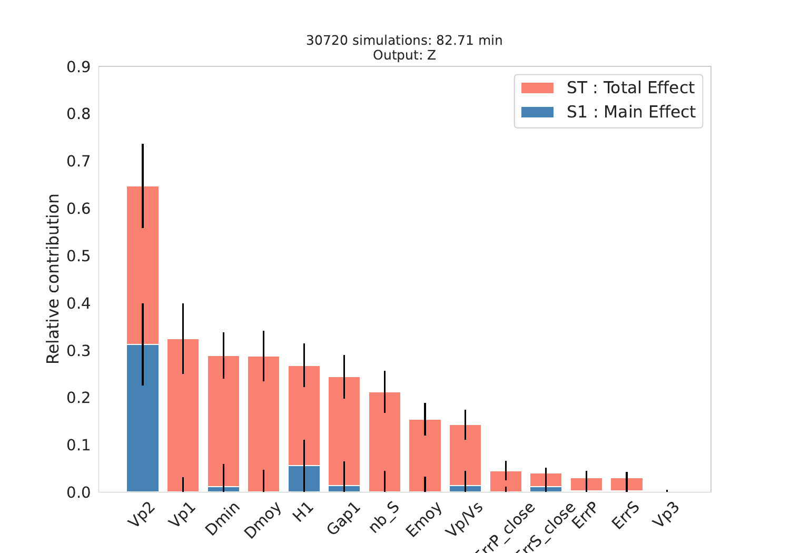

# GSA-Loc

**Global Sensitivity Analysis for earthquake location**

GSA-Loc applies a global sensitivity analysis framework (Sobol indices and Morris elementary effects) to earthquake location, in order to understand which input parameters drive location errors and uncertainties.

- **Version:** 1.0
- **Author:** Marine Laporte
- **Contact:** marinelaporte.ensg [at] gmail.com



-->

---

## Citation

If you use this code, please cite:

> Laporte, M., Letort, J., Bertin, M., & Bollinger, L. (2024). Understanding earthquake location uncertainties using global sensitivity analysis framework. *Geophysical Journal International*, 237(2), 1048–1060.

---

## Installation

### Dependencies

- Python 3
- Python libraries:
  - [SALib](https://salib.readthedocs.io/en/latest/)
  - pandas, numpy, matplotlib, scipy
  - seaborn

```bash
pip install SALib pandas numpy matplotlib scipy seaborn
```

### Earthquake location algorithms

GSA-Loc calls an external earthquake location algorithm (ELA). It must be installed separately and callable directly from your terminal.


#### Hypo71 (Lee and Lahr, 1975)

Install Hypo71, then copy the compiled executable into the `hypo71/` folder of this repository, under the name `hypo`:

```bash
cp /path/to/your/Hypo71/executable ./hypo71/hypo
chmod +x ./hypo71/hypo
```

GSA-Loc runs Hypo71 through the script `hypo71/c_hypo`, which calls `./hypo71/hypo`.

#### NonLinLoc (Lomax et al., 2000)

Install NonLinLoc and add its `bin` directory to your `PATH`.

Temporarily, in your terminal:

```bash
export PATH=$PATH:$HOME/source/NonLinLoc_main/src/bin
```

Or permanently, by adding the same line to your `~/.bashrc`.

#### Other location algorithms

To run a sensitivity analysis with another earthquake location algorithm, rewrite Steps 5 to 7 of the `Locate` function in `locate_nll.py`:

5. Write the input phase file of the ELA
6. Write the parameter file of the ELA
7. Read the output file of the ELA

#### References

- Lee, W. H., & Lahr, J. C. (1975). *HYPO71 (revised): a computer program for determining hypocenter, magnitude, and first motion pattern of local earthquakes* (Open-File Report 75-311). US Geological Survey.
- Lomax, A., Virieux, J., Volant, P., & Berge, C. (2000). Probabilistic earthquake location in 3D and layered models: Introduction of a Metropolis-Gibbs method and comparison with linear locations. In C. H. Thurber & N. Rabinowitz (Eds.), *Advances in Seismic Event Location* (pp. 101–134). Kluwer, Amsterdam.

---

## Running a Sobol analysis

```bash
python3 sobol_launch.py
```

The configuration of the analysis is set directly in `sobol_launch.py`, in the definition of the problem. For example, to change the depth of the initial (synthetic) location, edit `depth_synth` in the section `### Define simulation parameters ###`.

---

## Figures

`sobol_launch.py` automatically creates figures when running a Sobol simulation. To add or remove figures, comment or uncomment the corresponding lines in the `### Sobol Indexes ###` and `### Plotting ###` sections.

**Section *Computes and plot Sobol indexes*:**

- For each output: total and main effect contributions of all random variables, as a bar chart (Laporte et al., 2024, Fig. 5).
- For each output: total, main and second-order Sobol indices (interactions) between all random variables, as a radial plot (Laporte et al., 2024, Fig. 6).
- For each output: distribution of the output (y-axis) relative to each random variable (x-axes).

**Section *Additional plots*:**

- For each difference between output and synthetic location: distribution of the difference (y-axis) relative to each random variable (x-axes) (Laporte et al., 2024, Fig. 7).
- 5 × 5 symmetric matrix of the inter-dependencies between outputs (Laporte et al., 2024, Fig. 4).
- Histograms of errors (difference from the initial location) and uncertainties (computed from the relocation).

**Section *Additional plots* (Morris):**

- Elementary effects of the Morris sensitivity analysis (standard deviation vs. mean) (Laporte et al., 2024, Supplementary Materials).

---

## Outputs

Total (ST) and main (S1) Sobol indices, with their confidence intervals, are written as `.txt` files in the `./out` folder.

Second-order Sobol indices can be saved with:

```python
total_Si, first_Si, second_Si = Si.to_df()
np.savetxt(f"Secondary_Indexes_{output}.txt", second_Si)
```

---

## License

This project is distributed under the MIT License. See [LICENSE](LICENSE).
